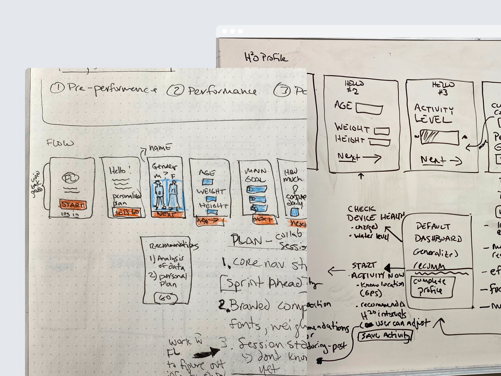
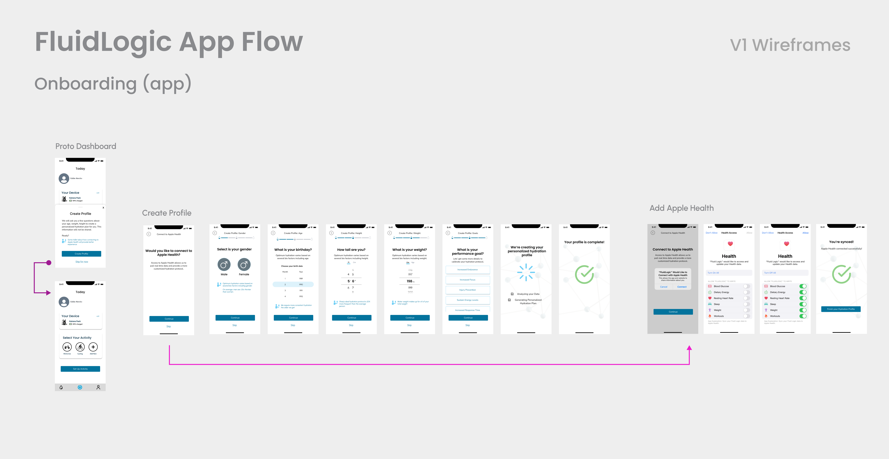
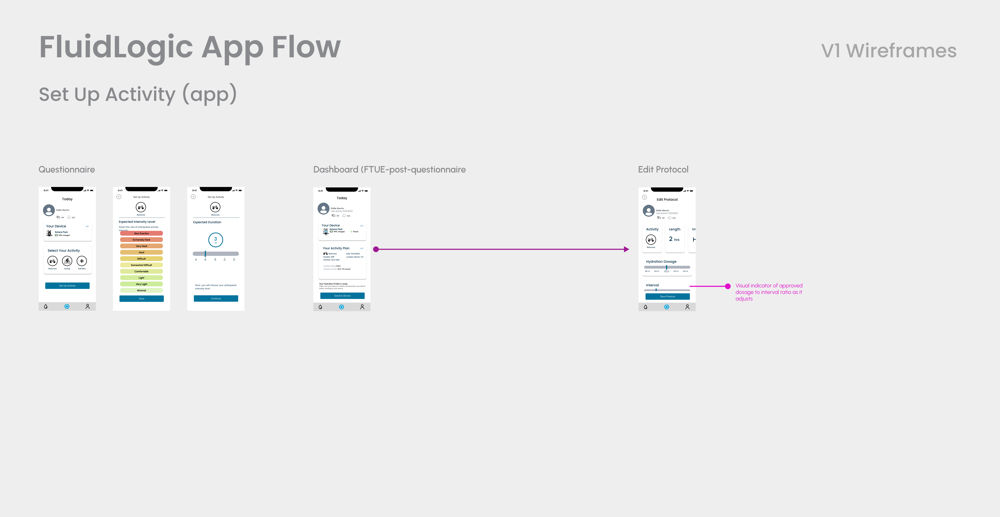
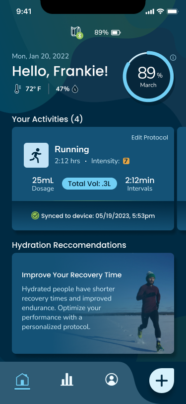
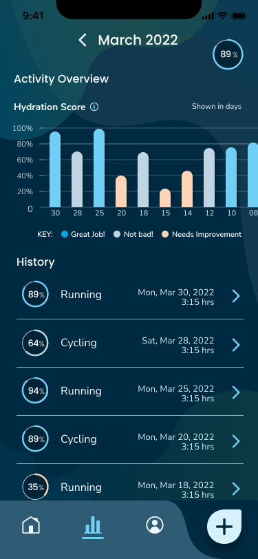
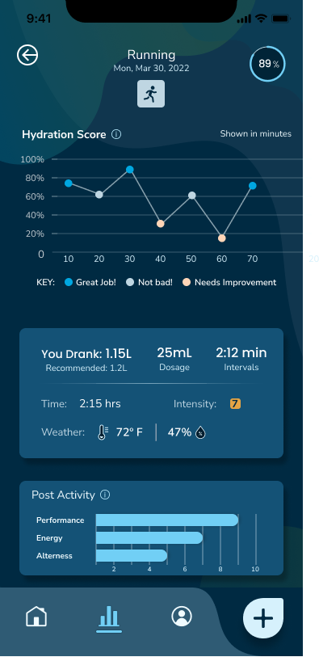
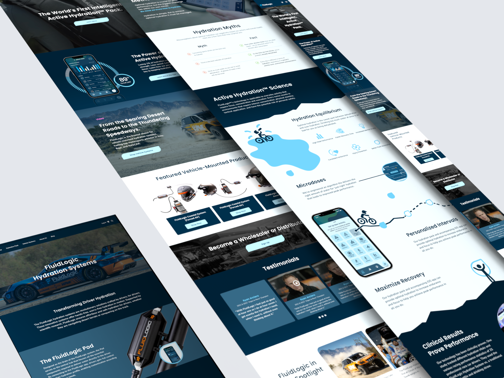

## The challenge

### Help people prepare, then get out of their way

FluidLogic was expanding beyond its in-car hydration systems for racing into a consumer experience. The companion app and the physical device were being developed alongside one another, so designing a screen flow also meant deciding what information needed to move between them.

The central goal was to let someone set up their hydration plan before an activity, then rely on the device rather than keep returning to their phone.

## Approach

### Define the journey before designing the screens

Before opening Figma, I sketched the user flow and worked through it with the client in a series of working sessions. We considered the experience before, during, and after an activity: creating a profile, setting up a plan, sending it to the device, and reviewing the activity afterward.

## Onboarding

### Turn personal information into a hydration profile

The onboarding wireframes explored how to collect the information needed for a personalized profile in manageable steps. They covered age, height, weight, and performance goals, alongside a route to connect Apple Health.

The screens explain why information is being requested and show progress through the setup. These are early design artifacts, showing how I structured the experience before its visual design was finalized.

## Activity setup

### Make the plan and the device handoff explicit

The activity setup flow explored selecting an activity, anticipating intensity and duration, and reviewing the resulting hydration plan. It also included a way to adjust dosage and intervals before sending the plan to the device.

In the later dashboard design, the activity card brings together the plan’s key information: dosage, total volume, and intervals. A timestamped sync confirmation makes the handoff to the device visible. That detail connects the interface back to the central design goal—helping people know they are ready to begin.

## After the activity

### Give the data a useful place to return to

The history view organizes previous activities alongside hydration scores. An individual activity view adds detail: hydration over time, volume consumed, dosage, intervals, activity conditions, and post-activity feedback.

Together, these designs extend the experience beyond setup, giving people a way to revisit what happened after using the device.

## Marketing experience

### Carry the product story onto the website

Alongside the companion app, I led the marketing website design and content strategy. The website introduced the hydration systems and explained the connected experience through product imagery, app visuals, and information about the approach to hydration.

## Outcomes

### A connected hydration ecosystem, launched in 2025

The FluidLogic product launched in 2025, bringing together the companion app, smart hydration device, and marketing website into a connected product ecosystem. Together, <a href="https://www.loft.design/" target="_blank" rel="noopener noreferrer">Loft.design</a> and FluidLogic created an experience that helps people plan their hydration, stay focused during an activity, and review their results afterward.

My contribution spanned product strategy, UX and visual design direction, UI writing, and the marketing experience. I helped connect how people discovered the product, prepared to use it, and interacted with it over time.
